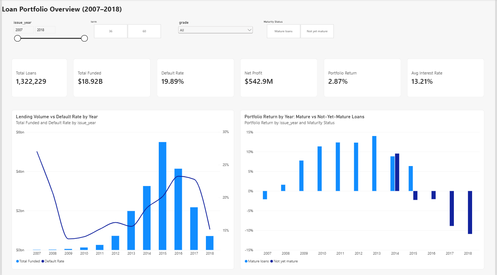
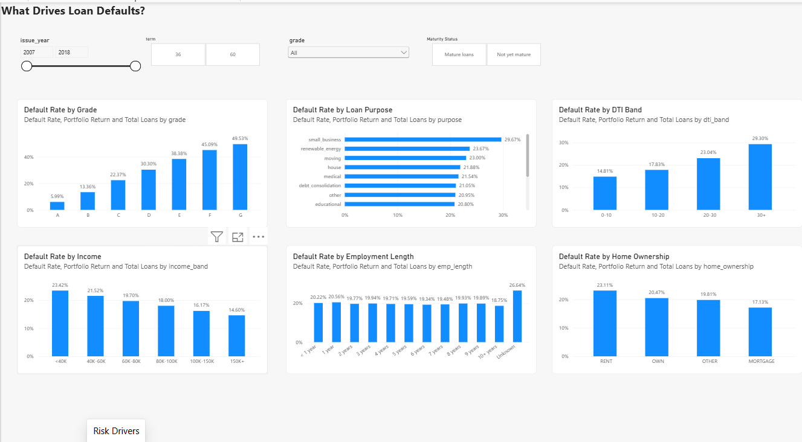
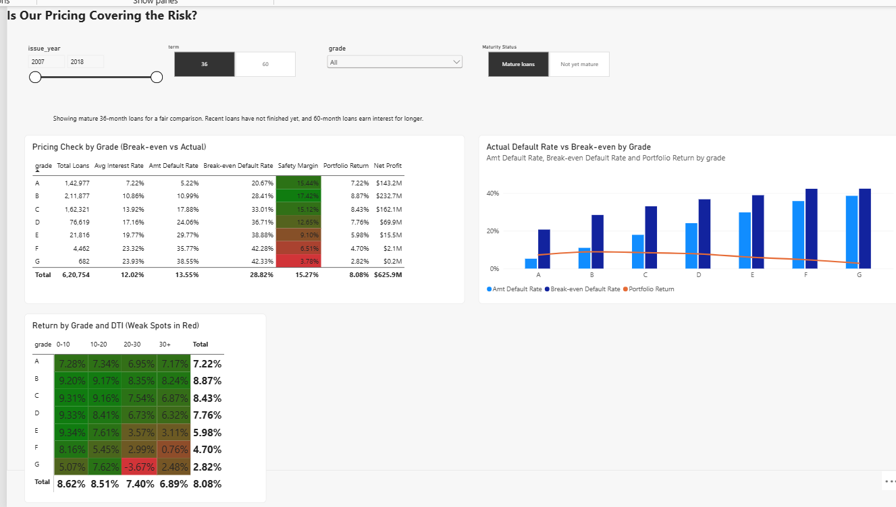
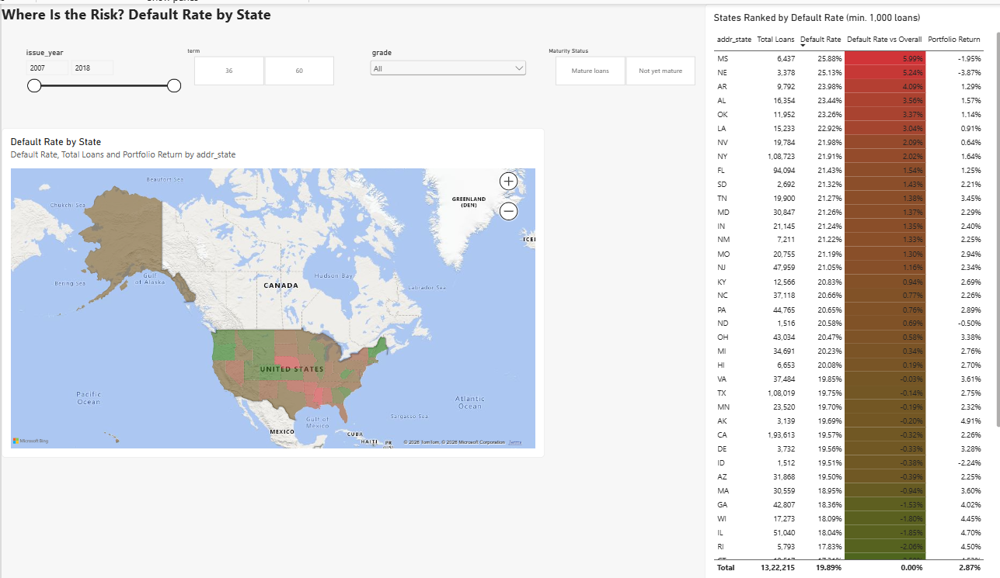
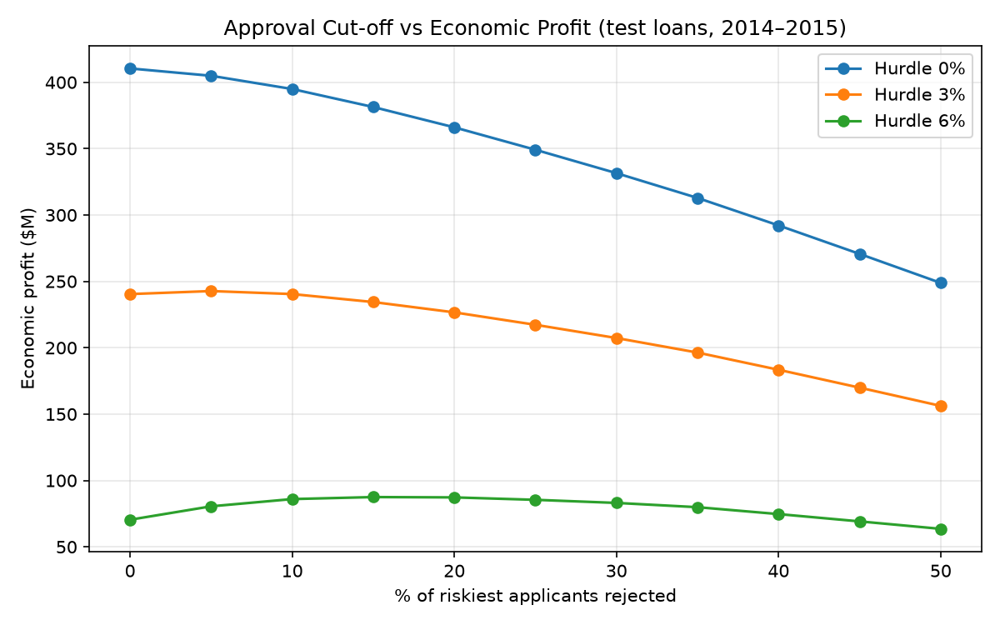
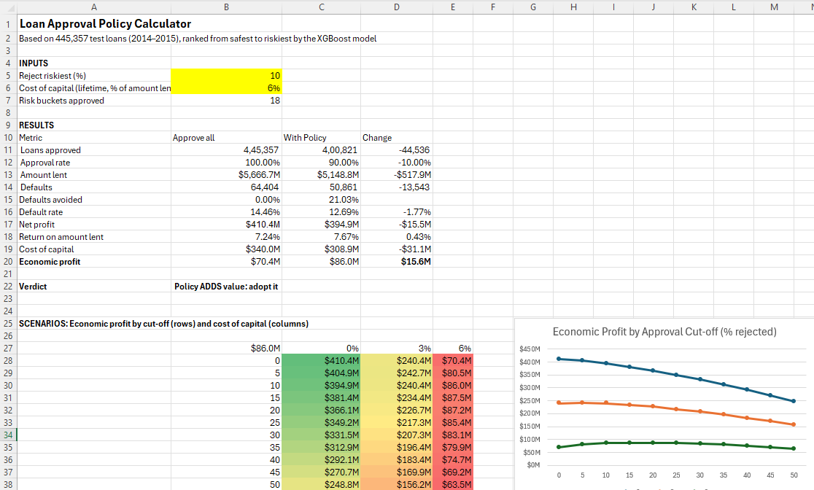
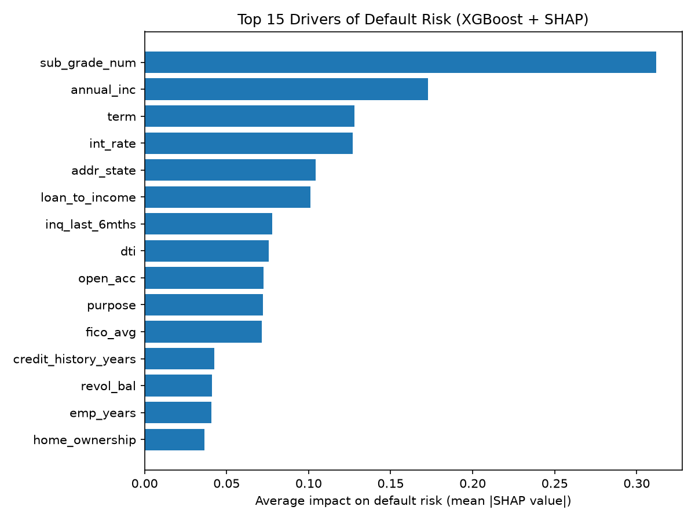

# Loan Default Risk & Portfolio Analysis

End-to-end analysis of **1.32 million Lending Club loans (2007–2018)**: why borrowers default, whether loans are priced correctly for their risk, and which approval policy maximises profit.
**Python · SQL (PostgreSQL) · Power BI · Excel · XGBoost · SHAP**

---

## Key Results
- **Recommended policy:** decline the riskiest 10% of applicants using the risk model → avoids **21% of defaults** for a **9% loss in volume**, and adds **$15.6M of economic profit** (at a 6% cost of capital)
- **Model beats the lender's own grade:** at the same decline rate, it avoids ~930 more defaults and adds **$10.1M more** economic profit than declining by Lending Club's sub-grade
- **Riskier loans are under-priced:** return peaks in grades B–C (8.9%) and falls to **2.8% in grade G**, whose safety margin over break-even is only 3.8 points
- **Risk model:** XGBoost, **AUC 0.683 / Gini 0.367**; the riskiest 10% of applicants default **9.2× more** than the safest 10%

---

## Business Problem
Acting as a data analyst at a consumer lending company, leadership asks:
1. Why do borrowers default, and which segments carry the most risk?
2. Are interest rates high enough to cover the losses from defaults?
3. Can we predict risky applicants at the time of application?
4. What approval policy reduces losses while protecting business volume and profit?

Full list of the 11 business questions: [`docs/business_questions.md`](docs/business_questions.md)

---

## Dashboard (Power BI)

**Portfolio Overview:** KPIs, lending volume and default rate by year, and the effect of loan maturity on returns


**Risk Drivers:** default rate by grade, purpose, DTI, income, employment and home ownership


**Pricing & Profitability:** actual default rate vs break-even default rate by grade, and a return heatmap by grade × DTI


**Geography:** default rate by state


---

## Approval Policy Simulation
Every risk bucket was profitable in raw dollars, so a naive analysis says "approve everyone". But the riskiest 5% returned only 2.1% over 3 years, below the cost of capital. Including a **cost of capital (hurdle rate)** changes the decision:



| Decline riskiest | Defaults avoided | Volume lost | Default rate | Economic profit (6% hurdle) |
|---|---|---|---|---|
| 0% (approve all) | 0% | 0% | 14.46% | $70.4M |
| **10% (recommended)** | **21.0%** | **9.1%** | **12.69%** | **$86.0M** |
| 15% | 29.4% | 13.6% | 12.00% | $87.5M |

The 10% cut-off is robust: it breaks even when capital is cheap and sits on the flat, near-optimal part of the curve.

### Excel What-If Calculator
A manager picks a decline % and a cost of capital and instantly sees approvals, defaults avoided, profit, economic profit and a verdict, plus a full scenario table (Excel Data Table).



---

## Risk Model
| Model | AUC | Gini |
|---|---|---|
| Lending Club sub-grade (baseline) | 0.6712 | 0.3425 |
| Logistic Regression | 0.6764 | 0.3528 |
| **XGBoost** | **0.6834** | **0.3668** |

- **No data leakage:** only the 26 features known at the time of application were used
- **Time-based validation:** trained on 2007–2013 loans, tested on 2014–2015 loans (the past predicts the future)
- **Explained with SHAP:** top drivers are sub-grade, income, FICO, loan-to-income, recent credit inquiries, DTI and missing employment



---

## Approach
| Phase | What was done | Tools |
|---|---|---|
| 1. Business questions | Defined stakeholders, 11 questions, the default definition and success metrics | Markdown |
| 2. Data cleaning | 2.26M raw rows → 1.32M clean loans; memory-efficient chunked loading on an 8 GB laptop; missing values, outliers, 13 engineered features including profit per loan | Python (pandas) |
| 3. Database | Bulk-loaded into PostgreSQL with COPY; primary key and indexes | PostgreSQL, SQLAlchemy |
| 4. SQL analysis | CTEs, window functions (LAG, RANK, PARTITION BY), FILTER, break-even pricing analysis | SQL |
| 5. Dashboard | 4-page interactive dashboard connected to PostgreSQL; 17 DAX measures incl. a live break-even pricing check | Power BI, DAX |
| 6. Risk model | Baseline vs Logistic Regression vs XGBoost; risk deciles; SHAP | scikit-learn, XGBoost, SHAP |
| 7. Recommendations | Approval-cut-off simulation with cost of capital; model vs grade; Excel what-if calculator | Python, Excel |

### Analytical issues caught along the way
- **Maturity bias:** 2016–2018 loans looked unprofitable only because they had not finished yet → used mature loans for profitability and pricing
- **Term-mix effect:** returns seemed to rise from grade A to G, but only because riskier grades had more 60-month loans → re-tested with 36-month loans only
- **Joint applications:** the lowest incomes ($1) were joint loans using a different income field → scoped the project to individual applications

---

## Project Structure
```
project1-loan-default-risk/
├── data/
│   ├── raw/                  # Lending Club dataset from Kaggle (not included)
│   └── processed/            # clean data, predictions, model outputs
├── notebooks/
│   ├── 01_data_cleaning.ipynb
│   ├── 02_load_to_postgres.ipynb
│   ├── 03_risk_model.ipynb
│   └── 04_policy_simulation.ipynb
├── sql/
│   ├── 00_setup_table.sql
│   ├── 01_portfolio_overview.sql
│   ├── 02_risk_drivers.sql
│   ├── 03_pricing_profitability.sql
│   └── 04_dashboard_views.sql
├── dashboard/
│   ├── loan_risk_dashboard.pbix
│   └── dax_measures.dax
├── excel/
│   └── loan_policy_calculator.xlsx
├── models/
│   └── xgb_default_model.json
├── docs/                     # business questions, cleaning summary, SQL findings, model summary, recommendations
├── images/                   # dashboard and chart screenshots
├── requirements.txt
└── README.md
```

---

## Documentation
| Document | Contents |
|---|---|
| [`business_questions.md`](docs/business_questions.md) | Objective, stakeholders, scope, 11 business questions |
| [`data_cleaning_summary.md`](docs/data_cleaning_summary.md) | Row funnel, missing values, outliers, engineered features |
| [`sql_findings.md`](docs/sql_findings.md) | Results and insights for every SQL question |
| [`model_summary.md`](docs/model_summary.md) | Features, validation, model comparison, deciles, SHAP |
| [`recommendations.md`](docs/recommendations.md) | Policy simulation, final recommendations, assumptions |

---

## How to Run
1. **Get the data:** download the [Lending Club dataset from Kaggle](https://www.kaggle.com/datasets/wordsforthewise/lending-club) and extract it into `data/raw/archive/`
2. **Install Python 3.12** and the libraries: `pip install -r requirements.txt`
3. **Install PostgreSQL** and create a database named `loan_risk`
4. **Run the notebooks in order:** `01` → `02` (asks for your PostgreSQL password at runtime) → `03` → `04`
5. **Run the SQL scripts** in `sql/` (in order) in pgAdmin or psql
6. **Open the dashboard** in Power BI Desktop and refresh with your own database credentials
7. **Open the Excel calculator** in `excel/`

---

## Limitations
- The policy was tested on 2014–2015 loans; mature test loans are all 36-month
- Outcomes of declined applicants are never observed (reject inference is out of scope)
- Cost of capital is applied as a simple lifetime % of the amount lent
- Returns are lifetime, not annualised

---

## Author
**Naman Rajyagor** · [LinkedIn](https://www.linkedin.com/in/naman-rajyagor-51828228b)